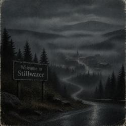

# OpenGameArt: music

**26 assets from [OpenGameArt](https://opengameart.org), dedicated to the public domain under [CC0](https://creativecommons.org/publicdomain/zero/1.0/).** Use them in any game, free or paid, and change them however you like; no credit is needed.

Music from OpenGameArt entries licensed CC0 (some also offer other licences; CC0 is the one that applies here). 592.8 MB in all.

This is a copy kept by [zuujis-cc0](https://github.com/zuujis-cc0) so game makers can take single files from GitHub. It is not made by or affiliated with OpenGameArt: the originals, often in more formats and higher resolutions, are on [opengameart.org](https://opengameart.org). If they help you, consider [supporting OpenGameArt](https://opengameart.org/content/faq).

Every file is listed in [MANIFEST.tsv](MANIFEST.tsv) with its size and SHA-256. More free assets: [the Zuujis collection](https://github.com/zuujis-cc0/free-game-assets#readme).

| | | | |
| :-: | :-: | :-: | :-: |
| <b><a href="005">005</a></b> by Some Weirdo · <a href="https://opengameart.org/content/005">source</a> | <b><a href="028">028</a></b> by Some Weirdo · <a href="https://opengameart.org/content/028">source</a> | <b><a href="1-ton-fanfare-day-10">1-Ton Fanfare - Day 10</a></b> by Zane Little Music · <a href="https://opengameart.org/content/1-ton-fanfare-day-10">source</a> | <b><a href="vintage-menu">Vintage Menu</a></b> by iamoneabe · <a href="https://opengameart.org/content/vintage-menu">source</a> |
| <b><a href="viral-infection">Viral Infection</a></b> by iamoneabe · <a href="https://opengameart.org/content/viral-infection">source</a> | <b><a href="vow-to-fulfill">Vow to Fulfill</a></b> by Centurion_of_war · <a href="https://opengameart.org/content/vow-to-fulfill">source</a> | <b><a href="waiting-0">Waiting...</a></b> by Umplix · <a href="https://opengameart.org/content/waiting-0">source</a> | <b><a href="wapa">Wapa</a></b> by StumpyStrust · <a href="https://opengameart.org/content/wapa">source</a> |
| <b><a href="warp-drive">Warp Drive</a></b> by vitalezzz · <a href="https://opengameart.org/content/warp-drive">source</a> | <b><a href="wednesday-night-funk-fusion">Wednesday Night [Funk Fusion]</a></b> by Zane Little Music · <a href="https://opengameart.org/content/wednesday-night-funk-fusion">source</a> |  <b><a href="welcome-to-stillwater">Welcome to Stillwater</a></b> by Tsorthan Grove · <a href="https://opengameart.org/content/welcome-to-stillwater">source</a> | <b><a href="western-rock-metal-song">Western rock-metal song</a></b> by ShggothSlave · <a href="https://opengameart.org/content/western-rock-metal-song">source</a> |
|  <b><a href="where-is-he">Where is He?</a></b> by Eldritch Grim · <a href="https://opengameart.org/content/where-is-he">source</a> | <b><a href="whiplash">Whiplash</a></b> by iamoneabe · <a href="https://opengameart.org/content/whiplash">source</a> | <b><a href="white-hat">White Hat</a></b> by vitalezzz · <a href="https://opengameart.org/content/white-hat">source</a> | <b><a href="white-limestone">White Limestone</a></b> by Bobjt · <a href="https://opengameart.org/content/white-limestone">source</a> |
| <b><a href="wierd-dissonant-bells">Wierd dissonant bells</a></b> by genderfreak · <a href="https://opengameart.org/content/wierd-dissonant-bells">source</a> | <b><a href="wildlife">Wildlife</a></b> by iamoneabe · <a href="https://opengameart.org/content/wildlife">source</a> | <b><a href="win-fanfare">Win Fanfare</a></b> by gchoc · <a href="https://opengameart.org/content/win-fanfare">source</a> | <b><a href="yenab-landing">Yenab Landing</a></b> by Tozan · <a href="https://opengameart.org/content/yenab-landing">source</a> |
| <b><a href="yenab-marketplace">Yenab Marketplace</a></b> by Tozan · <a href="https://opengameart.org/content/yenab-marketplace">source</a> | <b><a href="yenab-outskirts">Yenab Outskirts</a></b> by Tozan · <a href="https://opengameart.org/content/yenab-outskirts">source</a> | <b><a href="you-must-love-god-or-he-will-kill-you">You Must Love God, Or He Will Kill You</a></b> by Spring Spring · <a href="https://opengameart.org/content/you-must-love-god-or-he-will-kill-you">source</a> | <b><a href="yurban-outskirts-area">Yurban Outskirts Area</a></b> by Tozan · <a href="https://opengameart.org/content/yurban-outskirts-area">source</a> |
| <b><a href="zelda-like-dungeon-theme">Zelda-like Dungeon theme</a></b> by genderfreak · <a href="https://opengameart.org/content/zelda-like-dungeon-theme">source</a> | <b><a href="zen-theme">Zen Theme</a></b> by beardalaxy · <a href="https://opengameart.org/content/zen-theme">source</a> |  |  |

---

Kept up to date by this repository's own [update workflow](.github/workflows/update.yml), with code and plan from [cc0-mirror](https://github.com/zuujis-cc0/cc0-mirror). Something wrong? [Open an issue there](https://github.com/zuujis-cc0/cc0-mirror/issues/new) or use the [private report form](https://games.zuujis.com/report).
